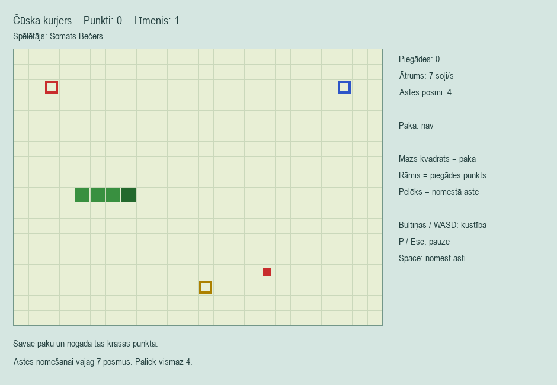
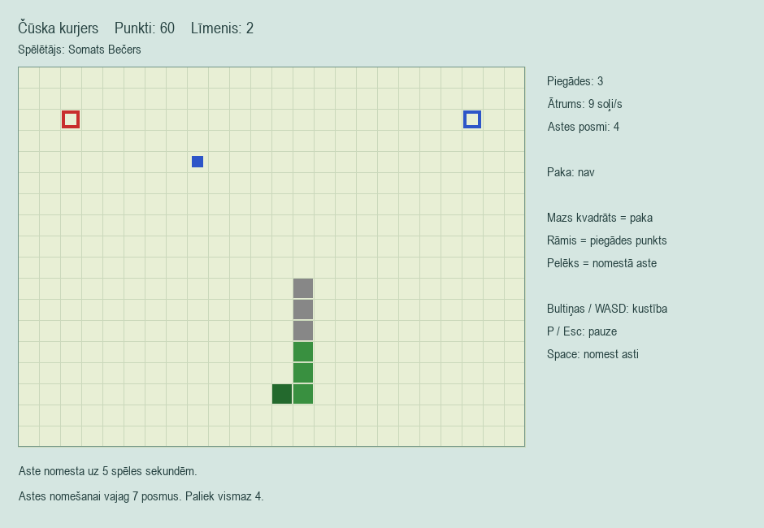
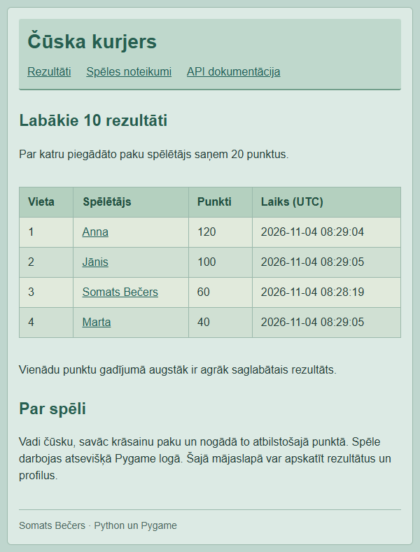

# Čūska kurjers

Autors: Somats Bečers.

Vienkārša Snake spēle ar paku piegādi un astes nomešanu. Spēle darbojas
Pygame logā. FastAPI serveris saglabā rezultātus SQLite datubāzē un atdod
HTML mājaslapu ar līderu tabulu, spēlētāja profilu un noteikumiem.

## Palaišana Windows datorā

Nepieciešams Python 3.11 vai jaunāks un internets bibliotēku uzstādīšanai.
Python instalēšanas laikā atzīmē `Add Python to PATH`.
Ieteicamā versija ir Python 3.12, ar kuru projekts pārbaudīts.

1. Izpako visu projekta mapi.
2. Pirmo reizi palaid `setup.bat`. Tas izveido `.venv` un uzstāda bibliotēkas.
3. Palaid `start_server.bat` un atstāj servera logu atvērtu.
4. Palaid `start_game.bat`.
5. Pārlūkā atver <http://127.0.0.1:8000>.

Turpmāk pietiek ar trešo un ceturto soli. Serveri aptur ar Ctrl+C tā logā.
Spēli aizver ar loga aizvēršanas pogu vai Esc izvēlnē.
Ja ports 8000 jau aizņemts, vispirms apturi iepriekš palaisto serveri.

## Palaišana terminālī

Visas komandas izpilda projekta `spele` mapē.

```powershell
python -m venv .venv
.venv\Scripts\python.exe -m pip install -r requirements.txt
.venv\Scripts\python.exe -m uvicorn api.main:app --host 127.0.0.1 --port 8000
```

Otrā terminālī:

```powershell
.venv\Scripts\python.exe -m client.main
```

Linux un macOS vidē izmanto `.venv/bin/python` Windows ceļa vietā.
Komanda `python -m client.main` ir jāizpilda no projekta saknes,
nevis no `client/` mapes.

## Spēles noteikumi

Izvēlnē ievada vārdu no 1 līdz 24 rakstzīmēm. Atļauti burti, cipari,
atstarpes, apostrofs, pasvītrojums un defise. Vārdi atšķir lielos un mazos
burtus, tāpēc vienmēr lieto vienu rakstību.

| Taustiņš | Darbība |
| --- | --- |
| Bultiņas vai WASD | Mainīt virzienu |
| P vai Esc | Pauze un turpināšana |
| Space | Nomest pēdējos trīs astes posmus |
| Enter | Sākt spēli vai pēc beigām atvērt izvēlni |
| F5 izvēlnē | Atkārtoti ielādēt topu |

Mazs krāsains kvadrāts ir paka, rāmis ir piegādes punkts, zaļie posmi ir
čūska, pelēkie posmi ir nomestā aste. Savāc vienu paku un nogādā tādas
pašas krāsas punktā. Nepareizās krāsas punkts neko nemaina.

- Par piegādi: 20 punkti un viens jauns astes posms.
- Par pakas savākšanu vien: 0 punktu.
- Ja ir vismaz 7 posmi, var nomest pēdējos 3, atstājot vismaz 4.
- Nomestā aste ir šķērslis 5 spēles sekundes. Pauzē laiks neiet.
- 1. līmenis: 0–2 piegādes, 7 soļi sekundē.
- 2. līmenis: 3–5 piegādes, 9 soļi sekundē.
- 3. līmenis: no 6 piegādēm, 11 soļi sekundē.

Sadursme ar sienu, ķermeni vai nomesto asti beidz spēli. Ja jaunai pakai
nav vietas, spēlētājs uzvar. Zaudējot loga fokusu, spēle automātiski pauzējas.





## Serveris un mājaslapa

| Metode | Adrese | Rezultāts |
| --- | --- | --- |
| POST | `/scores` | Saglabā vārdu un punktus, 201 |
| GET | `/scores/top` | Labākās 10 spēles, 200 |
| GET | `/players/{name}/stats` | Spēļu skaits un labākais rezultāts, 200 vai 404 |
| GET | `/` | HTML līderu tabula |
| GET | `/players/{name}` | HTML profils, 200 vai 404 |
| GET | `/rules` | Apraksts un noteikumi |
| GET | `/docs` | Interaktīva Swagger API dokumentācija |

`POST /scores` pieprasījuma JSON piemērs:

```json
{"name": "Somats Bečers", "score": 60}
```

Atbilde satur `id`, `name`, `score`, `created_at`. Serveris pats nosaka
saglabāšanas laiku UTC. Statistikā lauki ir `name`, `games`, `best_score`.
Topā rāda labākās 10 spēles, tāpēc viens spēlētājs var parādīties vairākreiz.
Vienādu punktu gadījumā agrāk saglabātais rezultāts ir augstāk.

Tukšs JSON, tukšs vai pārāk garš vārds, negatīvi punkti, decimāldaļa,
teksts punktu vietā un papildu JSON lauki dod 422. Nezināms spēlētājs dod 404.
SQL vaicājumos izmanto `?` parametrus, nevis lietotāja ievades salīmēšanu.

Datubāze `data/scores.db` izveidojas automātiski. Tā nav jāveido ar roku,
un tā netiek pievienota Git. Rezultāti saglabājas pēc servera pārstartēšanas.
Komplektā datubāze ir tukša. Ekrānuzņēmumu piemēri tapuši atsevišķā testa datubāzē.
Mājaslapa izmanto Jinja veidnes un vienu CSS failu, bez sava JavaScript.



## Ja serveris nav pieejams

Spēli var spēlēt arī bez servera. Izvēlnē redzams paziņojums, bet spēle
turpinās. HTTP pieprasījumi darbojas fona pavedienos un izmanto noildzi,
tāpēc tie neaptur loga zīmēšanu. Spēles beigās rezultātu nosūta vienu reizi.
Ja nav saņemts apstiprinājums, parādās kļūdas paziņojums. Automātiskas
atkārtotas sūtīšanas nav, lai savienojuma kļūmes dēļ nerastos dublikāti.
Ja logs aizvērts pirms pieprasījuma pabeigšanas, saglabāšana nav garantēta.

Pēc servera ieslēgšanas izvēlnē nospied F5. Servera adresi var mainīt ar
vides mainīgo `SPELE_API_URL`, bet datubāzes ceļu ar `SPELE_DB`.
Šis ir lokāls mācību serveris: rezultātus iesūta klients, lietotāju kontu nav.

## Projekta uzbūve

```text
spele/
  game/               noteikumi, kustība, sadursmes, līmeņi; bez pygame
    engine.py
    names.py
  client/             Pygame ievade, zīmēšana un HTTP klients
    main.py
    api_client.py
  api/                FastAPI maršruti, SQLite un Jinja mājaslapa
    main.py
    db.py
    templates/
    static/style.css
  docs/               spēles un mājaslapas ekrānuzņēmumi
  tests/              spēles, API un klienta pārbaudes
  Dizains.docx        sākotnējais spēles apraksts
  Prezentacija.pptx   6 slaidu PowerPoint prezentācija
  README.md
  requirements.txt
  requirements-dev.txt
  .gitignore
```

## Pārbaude

```powershell
.venv\Scripts\python.exe -m pip install -r requirements-dev.txt
.venv\Scripts\python.exe -m pytest -q
```

Testi izmanto pagaidu datubāzi. Tie pārbauda piegādes, augšanu, visas
grūtības pakāpes, astes nomešanu, pauzi, sadursmes, topa kārtošanu,
ievaddatu validāciju, profilus un datu saglabāšanos pēc pārstartēšanas.
Atsevišķi pārbaudīta Pygame ievade un zīmēšana, kā arī reāla sūtīšana serverim
un savienojuma atteikums.

## Bibliotēku dokumentācija

- [Pygame tastatūras ievade](https://www.pygame.org/docs/ref/key.html)
- [FastAPI Jinja veidnes](https://fastapi.tiangolo.com/advanced/templates/)
- [Requests kļūdas un noildze](https://requests.readthedocs.io/en/latest/user/quickstart/)

## Darbs VS Code

Atver visu projekta mapi. F5 palaiž konfigurāciju **Spēle**.
Serverim izvēlies konfigurāciju **Serveris** sadaļā **Run and Debug**.
Izvēlnē **Terminal → Run Task** pieejami uzdevumi **Spēle**, **Serveris**
un **Testi**. Visi izmanto projekta `.venv` vidi.
Īsa palaišanas pamācība ir failā [PALAISANA.md](PALAISANA.md).
